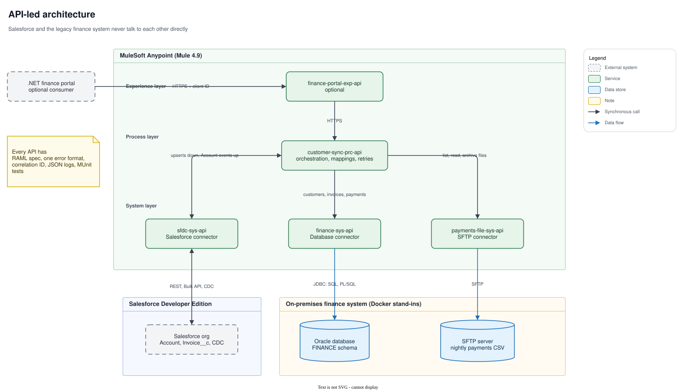

# Salesforce to finance integration POC (MuleSoft)

A small API-led integration between Salesforce and a legacy finance system,
built with Mule 4. The finance system is an Oracle database and an SFTP file
feed, both running in Docker to stand in for on-premises systems.



**[Integration design](docs/architecture.md)**: six diagrams with step-by-step
explanations of each flow, the data model, the proposed deployment and the field
mappings. The diagrams are editable `.drawio.svg` files in `docs/assets/`.

## Flows

| Flow | Direction | Pattern |
|---|---|---|
| Customer sync | Salesforce Account to finance customer | Change Data Capture event, idempotent upsert |
| Invoice sync | Finance invoice to Salesforce `Invoice__c` | Scheduled poll with a watermark, bulk upsert on an external ID |
| Payments file | Nightly CSV over SFTP to finance and Salesforce | Batch job with per-record error handling |

## Repository layout

| Path | Contents | Status |
|---|---|---|
| `infra/` | Docker Compose for Oracle Database Free and SFTP | Working |
| `db/` | Finance schema, stored procedures and seed data | Working |
| `samples/payments/` | Clean and deliberately bad payment files | Ready |
| `finance-sys-api/` | System API over the finance database | Built and verified end to end by a 49-check smoke test. MUnit suites written but not yet run (see below) |
| `salesforce/` | Salesforce metadata: `Invoice__c`, Account fields, Change Data Capture, permission set | Deployed |
| `sfdc-sys-api/` | System API over Salesforce | Runs against the Developer Edition org: JWT login, invoice upsert and account reads verified. Change Data Capture listener and account upsert not yet exercised |
| `payments-file-sys-api/` | System API over the SFTP feed | Not started |
| `customer-sync-prc-api/` | Process API: orchestration, mappings, reconciliation | Not started |
| `docs/` | [Integration design](docs/architecture.md) with diagrams and field mappings | Design written; runbook not started |

## Run the local systems

Needs Docker Desktop.

```powershell
cd infra
Copy-Item .env.example .env      # first time only; change the passwords if you like
docker compose up -d
docker compose ps                # wait for finance-db to show "healthy"
```

| System | Address | Login |
|---|---|---|
| Oracle | `localhost:1521`, service `FREEPDB1` | `FINANCE_DB_USER` / `FINANCE_DB_PASSWORD` from `.env` |
| SFTP | `localhost:2222`, folder `/payments` | `SFTP_USER` / `SFTP_PASSWORD` from `.env` |

The SFTP folders `inbound`, `archive` and `error` map to `infra/sftp-data/`.

The schema and seed data load once, when the database volume is first created.
To rebuild the database from scratch:

```powershell
docker compose down -v
docker compose up -d
```

Quick check:

```powershell
docker exec finance-db bash -c 'echo "select count(*) from invoices;" | sqlplus -s $APP_USER/$APP_USER_PASSWORD@//localhost/FREEPDB1'
```

## Build and test finance-sys-api

Needs JDK 17 (Mule 4.9 does not run on later versions) and Maven.

```powershell
cd finance-sys-api
mvn clean package -DskipMunitTests     # builds the deployable jar
```

The app reads the database password from the `FINANCE_DB_PASSWORD` environment
variable. Use the value from `infra/.env`.

**Running the MUnit tests.** The tests run on the Mule Enterprise runtime.
Maven can only download that runtime with MuleSoft customer repository
credentials, which trial accounts do not have. Run the tests from Anypoint Code
Builder or Anypoint Studio instead, which bundle the runtime. With customer
credentials in `~/.m2/settings.xml`, the command line works too:

```powershell
mvn clean test                              # unit tests, database mocked
mvn clean test "-Dintegration.tests=true"   # plus end-to-end tests against the Docker database
```

## Run finance-sys-api locally and smoke-test it

Needs a Mule Enterprise runtime. Anypoint Code Builder installs one under
`%USERPROFILE%\AnypointCodeBuilder\runtime` (command **MuleSoft: Install Runtime**).

```powershell
# from the runtime folder, with FINANCE_DB_PASSWORD and JAVA_HOME (JDK 17) set
Copy-Item <repo>\finance-sys-api\target\finance-sys-api-*-mule-application.jar apps\finance-sys-api.jar
bin\mule.bat console
```

Then, from Git Bash:

```bash
bash finance-sys-api/scripts/smoke-test.sh
```

The smoke test calls every endpoint against the Docker database: watermark
paging, the idempotent customer upsert, the reconciliation hash, payments
(applied, duplicate, unknown invoice, void invoice, invalid input), watermarks,
routing and correlation IDs. It creates only rows marked IT and removes them.

## Deploy the Salesforce metadata

Needs the Salesforce CLI and an authorised org.

```powershell
cd salesforce
sf project deploy start --target-org <alias> --source-dir force-app
sf org assign permset --name Finance_Integration --target-org <alias>
```

## Secrets

No credentials are stored in this repository. `infra/.env` is git-ignored;
`infra/.env.example` holds placeholder values for the local Docker containers
only.
