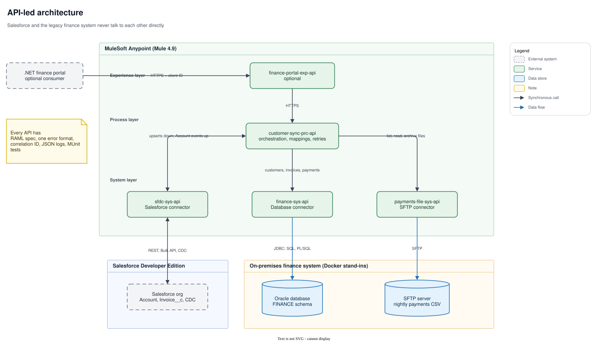
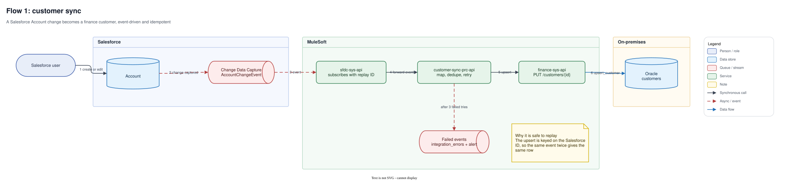
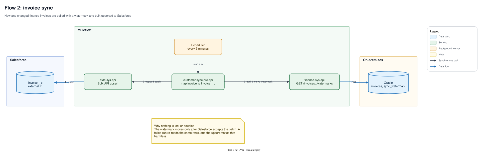
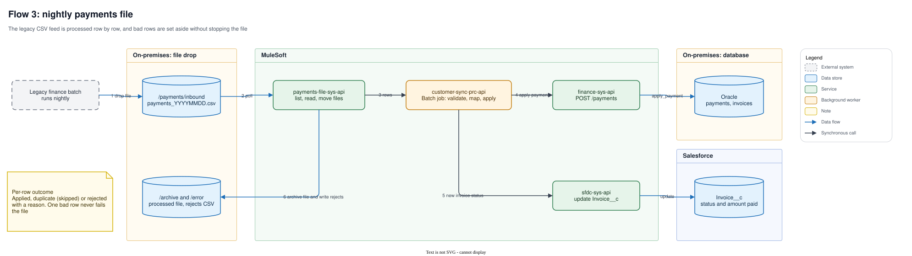
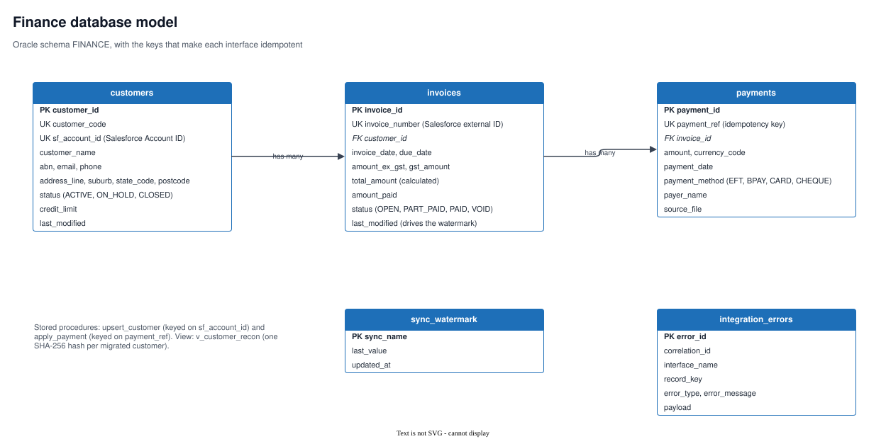
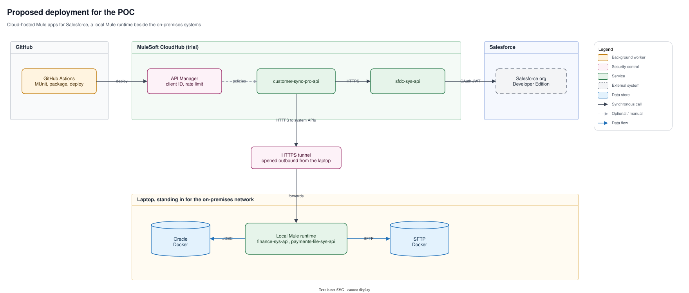

# Integration design

This document explains how Salesforce and the legacy finance system are
connected, flow by flow. The diagrams are editable: open any
`assets/*.drawio.svg` file in draw.io or the draw.io VS Code extension.

To regenerate the diagrams after changing a spec in `docs/diagrams/`, see
[Regenerating](#regenerating) at the end.

## Build status

| Part | Status |
|---|---|
| Finance database and SFTP server (Docker) | Built and tested |
| `finance-sys-api` | Built; see the project README for test status |
| Salesforce objects, fields and Change Data Capture (`salesforce/`) | Deployed to the Developer Edition org |
| `sfdc-sys-api` | Designed, not built |
| `payments-file-sys-api` | Designed, not built |
| `customer-sync-prc-api` | Designed, not built |
| `finance-portal-exp-api` | Optional, not built |
| CloudHub deployment and CI/CD | Proposed, not built |

## 1. The big picture

The integration is built in three layers. This is MuleSoft's API-led
connectivity pattern.

- **System APIs** each wrap one backend and hide how it works. `finance-sys-api`
  is the only thing that knows the finance system is an Oracle database with
  stored procedures. If finance moves to TechnologyOne, only this API changes.
- **The process API** holds the business logic: which system is the source of
  truth for what, how fields map, what to retry, and what to do with failures.
  It knows nothing about SQL, SFTP or the Salesforce SDK.
- **The experience API** (optional) shapes data for one consumer, such as a .NET
  portal.



What every API has in common:

- A RAML specification, written first, that validates requests before any code runs.
- One error format: `{"error": {"code", "message", "correlationId", "timestamp"}}`.
- A correlation ID taken from the `X-Correlation-ID` header (or generated),
  passed to every downstream call, returned on every response and written on
  every log line. One ID traces a record across all the APIs.
- JSON logs, one object per line.
- MUnit tests with the backend mocked, plus end-to-end tests against the real backend.

## 2. Flow 1: customer sync (Salesforce to finance)

**Trigger:** someone creates or edits an Account in Salesforce.
**Pattern:** event-driven, using Salesforce Change Data Capture.



1. A user creates or edits an Account.
2. Salesforce publishes an `AccountChangeEvent`. No polling and no Apex trigger is needed.
3. `sfdc-sys-api` is subscribed to the event channel. It stores the replay ID of
   the last event it handled, so after a restart it resumes where it stopped.
4. It forwards the event to `customer-sync-prc-api`.
5. The process API maps Account fields to customer fields (see
   [Field mapping](#field-mapping)) and calls `PUT /customers/{sfAccountId}` on
   `finance-sys-api`.
6. `finance-sys-api` calls the `upsert_customer` stored procedure, which inserts
   the customer or updates the existing one.

**Why the same event twice does no harm:** the upsert is keyed on the Salesforce
Account ID, which has a unique constraint. Delivering an event twice, or
replaying a day of events, produces the same rows.

**When it fails:** the process API retries transient failures (finance database
down, timeout) three times. After that it records the event in
`integration_errors` with its correlation ID and raises an alert. Bad data (for
example a state that is not an Australian state) is not retried, because it will
never succeed.

## 3. Flow 2: invoice sync (finance to Salesforce)

**Trigger:** a scheduler, every five minutes.
**Pattern:** polling with a watermark, then a bulk upsert.



1. The process API reads the watermark: the `last_modified` time of the last
   invoice it synced.
2. It asks `finance-sys-api` for invoices changed after that time. The page comes
   back oldest change first with a `nextWatermark`.
3. It maps each invoice to an `Invoice__c` record and sends the batch to `sfdc-sys-api`.
4. `sfdc-sys-api` bulk-upserts to Salesforce on the external ID field
   `Invoice_Number__c`.
5. Only after Salesforce accepts the batch does the process API move the
   watermark to `nextWatermark`.

**Why nothing is lost or doubled:**

- If step 4 fails, the watermark has not moved, so the next run reads the same invoices again.
- Reading them again is harmless because the upsert matches on the invoice number.
- A database trigger sets `last_modified` on every update, so a change made by
  any program is picked up.
- A page never splits invoices that share a timestamp (`FETCH FIRST n ROWS WITH
  TIES`), so moving the watermark can never skip a row.

## 4. Flow 3: nightly payments file (legacy feed)

**Trigger:** a CSV file appears in the SFTP inbound folder.
**Pattern:** batch processing with per-record error handling. This is the legacy
interface that would be retired once finance can send payments by API.



1. The legacy finance batch drops `payments_YYYYMMDD.csv` in `/payments/inbound`.
2. `payments-file-sys-api` picks the file up.
3. It hands the rows to a Batch Job in the process API. The file uses legacy
   formats: `DD/MM/YYYY` dates and amounts such as `"1,375.00"`. The process API
   validates and converts each row.
4. For each valid row it calls `POST /payments` on `finance-sys-api`, which calls
   the `apply_payment` stored procedure. The procedure records the payment and
   moves the invoice to part paid or paid.
5. The new invoice status is sent to Salesforce.
6. The file moves to `/payments/archive`. Rejected rows are written to a CSV in
   `/payments/error` with the reason for each.

**Each row ends in one of three ways:**

| Outcome | Example | What happens |
|---|---|---|
| Applied | A valid payment | Payment recorded, invoice status updated |
| Duplicate | A payment reference that was already applied | Skipped. Re-running a whole file is safe |
| Rejected | Unknown invoice, void invoice, bad date, missing amount | Written to the rejects file with a reason |

One bad row never fails the file. `samples/payments/` has a clean file and a
deliberately bad file, with the expected outcome of every row.

## 5. The finance database



The unique keys are what make each interface safe to repeat:

| Key | Makes this idempotent |
|---|---|
| `customers.sf_account_id` | Customer sync |
| `invoices.invoice_number` (the Salesforce external ID) | Invoice sync |
| `payments.payment_ref` | Payments file |

## 6. Deployment

This is a proposal. Nothing here is built yet.



- **CloudHub** runs the apps that only need the internet: the process API and
  `sfdc-sys-api`. All Salesforce traffic is outbound from MuleSoft, including the
  Change Data Capture subscription, so Salesforce never needs to reach in.
- **A local Mule runtime** runs the two system APIs that must sit beside the
  database and the SFTP server. This mirrors a real hybrid deployment, where a
  runtime inside the corporate network serves the on-premises systems.
- **An HTTPS tunnel**, opened outbound from the laptop, lets the process API in
  CloudHub call the two local system APIs. In a real network this would be a VPN
  or private link.
- **API Manager** applies client ID enforcement and rate limiting.
- **GitHub Actions** runs the MUnit tests, packages each app and deploys it.

The simplest demo skips CloudHub and runs all four apps locally. Salesforce
still works, because every call to it is outbound.

## Field mapping

### Salesforce Account to finance customer

| Salesforce Account | finance-sys-api | Oracle `customers` | Rule |
|---|---|---|---|
| `Id` | path `sfAccountId` | `sf_account_id` | 18 characters. The upsert key |
| `Name` | `name` | `customer_name` | Trimmed |
| `ABN__c` | `abn` | `abn` | Digits only: `51 824 753 556` becomes `51824753556` |
| `Accounts_Email__c` | `email` | `email` | Lower case |
| `Phone` | `phone` | `phone` | Trimmed |
| `BillingStreet` | `addressLine` | `address_line` | Trimmed |
| `BillingCity` | `suburb` | `suburb` | Trimmed |
| `BillingState` | `state` | `state_code` | Full name to code by lookup: `New South Wales` becomes `NSW` |
| `BillingPostalCode` | `postcode` | `postcode` | Four digits |
| `Account_Status__c` | `status` | `status` | Picklist to `ACTIVE`, `ON_HOLD` or `CLOSED` by lookup |
| `Credit_Limit__c` | `creditLimit` | `credit_limit` | Number |

`ABN__c`, `Accounts_Email__c`, `Account_Status__c` and `Credit_Limit__c` are custom
fields, deployed from `salesforce/`. `Finance_Customer_Code__c` is the external ID used by
the historical customer migration. The lookups live in the process API.

### Finance invoice to Salesforce Invoice__c

| Oracle `invoices` | finance-sys-api | Salesforce `Invoice__c` | Rule |
|---|---|---|---|
| `invoice_number` | `invoiceNumber` | `Invoice_Number__c` | External ID. The upsert key |
| `customer_id` | `sfAccountId` | `Account__c` | Lookup to the Account by its ID |
| `invoice_date` | `invoiceDate` | `Invoice_Date__c` | Date |
| `due_date` | `dueDate` | `Due_Date__c` | Date |
| `amount_ex_gst` | `amountExGst` | `Amount_Ex_GST__c` | Currency |
| `gst_amount` | `gstAmount` | `GST_Amount__c` | Currency |
| `total_amount` | `totalAmount` | `Total_Amount__c` | Currency |
| `amount_paid` | `amountPaid` | `Amount_Paid__c` | Currency |
| calculated | `balance` | `Balance__c` | Not sent. A Salesforce formula: total minus paid |
| `status` | `status` | `Status__c` | `PART_PAID` becomes `Part Paid`, and so on |
| `description` | `description` | `Description__c` | Text |

### Payments CSV to finance payment

| CSV column | finance-sys-api | Rule |
|---|---|---|
| `PAYMENT_REF` | `paymentRef` | Required. The idempotency key |
| `INVOICE_NO` | `invoiceNumber` | Required |
| `AMOUNT` | `amount` | Remove thousands separators: `"1,375.00"` becomes `1375.00`. Must be above zero |
| `CCY` | `currency` | Defaults to `AUD` |
| `PAY_DATE` | `paymentDate` | `DD/MM/YYYY` becomes `YYYY-MM-DD` |
| `METHOD` | `method` | One of `EFT`, `BPAY`, `CARD`, `CHEQUE` |
| `PAYER` | `payerName` | Optional |
| file name | `sourceFile` | For tracing a payment back to its file |

## Regenerating

The diagram specs are the YAML files in `docs/diagrams/`. From the repository root:

```powershell
C:\code\drawio-tools\.venv\Scripts\drawgen.exe doc docs\diagrams\architecture.md.tmpl `
  -d architecture=docs\diagrams\01-architecture.yaml `
  -d customer-sync=docs\diagrams\02-customer-sync.yaml `
  -d invoice-sync=docs\diagrams\03-invoice-sync.yaml `
  -d payments-file=docs\diagrams\04-payments-file.yaml `
  -d data-model=docs\diagrams\05-data-model.yaml `
  -d deployment=docs\diagrams\06-deployment.yaml `
  -o docs\architecture.md
```

Edit the text of this document in `docs/diagrams/architecture.md.tmpl`, not in
`docs/architecture.md`, which is generated.
